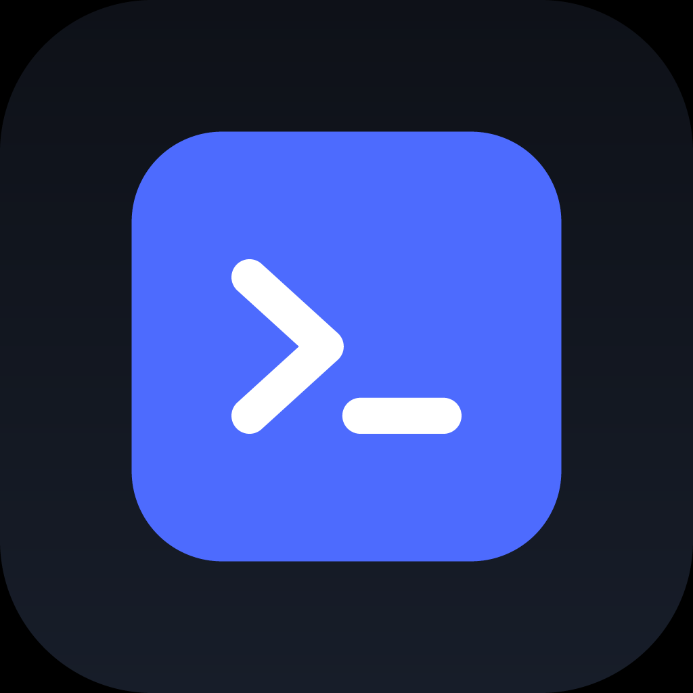

# DSH Pocket App

[dsh-pocket](https://github.com/shaobeichen/dsh-pocket) 的手机端。电脑上跑 dsh web，手机扫码连上去，看到的是同一个界面，实时同步。

Flutter 一套代码，Android 和 iOS 共用。

<p align="center">
  
</p>

## 来龙去脉

dsh-pocket 是 DSH 的插件，在电脑上起一个反向代理（默认 3081），把 `dsh web`（3080）转成手机能用的页面，还能开 cloudflared 公网隧道。它对外给的就是一条 URL：

| 场景 | 入口 | 认证 |
| --- | --- | --- |
| 局域网（同一 WiFi） | `http://192.168.1.5:3081` | 默认 8 位密码，可在电脑端关掉 |
| 公网（人在外面） | `https://xxx.trycloudflare.com` | 必须密码，每次开公网换新，也可自定义固定 |
| 命名隧道（固定域名） | `https://pocket.example.com` | 密码不自动轮换 |

界面是 DSH 自己的，这个 App 不重写它，只负责把「连上去」这件事做顺。浏览器也能打开那条链接，麻烦的地方在这里：

| 浏览器里 | 这个 App |
| --- | --- |
| 每次手输 8 位密码 | 密码存系统安全存储（Keystore / 钥匙串），进页面用 `?token=` 换好 cookie |
| 在家和在外面是两个地址，得记住哪个通 | 一台电脑存两条线路，进门先探活，局域网优先，不通转公网 |
| 公网地址重开就变，旧书签打不开 | 连上后自动把当前地址同步回来（见下文） |
| 电脑重启 dsh web 后掉登录态，卡在登录页 | 认出登录页就弹原生密码框，输一次继续用 |
| 局域网 `http://` 在 iOS 被 ATS 拦、Android 被明文策略拦 | 两个平台都放开了（只作用于本 App） |
| 电脑上 dsh web 没开，页面一片空白 | 明确提示「dsh web 没有在运行」 |
| 点开外链就回不来了 | 外链交给系统浏览器，App 只留 DSH |
| 想在大屏或折叠屏上用电脑布局 | 菜单里手机 / 电脑 / 自动三档，改完会记住 |

## 功能

- 扫码添加：对着电脑端「设置 → 手机访问」的二维码扫。CLI 版二维码里带了 `?token=` 的，密码一并读走。
- 两条线路自动选：局域网优先，失败回落公网；都不通时列出每条线路的探测结果，而不是白屏。
- 地址自动跟进：进页面后向 dsh-pocket 要一次当前状态，把公网域名和局域网 IP 同步回本地配置。电脑重启 dsh web、快速隧道换了随机域名之后，在家用局域网连一次就够，出门用的是新地址。
- 整屏显示：状态栏和底部导航栏透明，背景铺到屏幕边缘，没有那条色带（Android 15 起系统强制 edge-to-edge，这里对齐了）。
- 密码存一次就够：安全存储；dsh web 重启后自动重新握手。
- 移动端布局用的是 dsh-pocket 自己的适配（`?dsh-layout=` 可控），不是缩小的桌面网页。
- 每台电脑独立配置：名称、两条地址、默认线路、默认布局。
- 深色 / 浅色 / 跟随系统，观感和 DSH 本体一致。
- 复制入口链接（带密码，方便临时在别的浏览器里打开，别外传）。

## 下载

[Releases](https://github.com/Wangxiaolu0716/dsh-pocket-app/releases)

- `dsh-pocket-x.y.z.apk`：Android，直接装（debug 证书签名）
- `dsh-pocket-x.y.z-unsigned.ipa`：iOS，未签名，用 Sideloadly / AltStore 重签后装

## 构建

Android（本机，需要 Flutter + Android SDK）：

```powershell
flutter build apk --release
# → build\app\outputs\flutter-apk\app-release.apk
```

发布包（连更新服务器，带公告和赞赏入口）多一个 define：

```powershell
flutter build apk --release --target-platform android-arm64 --dart-define=OFFICIAL=true
```

一键发版（出包 → 传服务器 → GitHub Release）和 iOS 流程见 [docs/release.md](docs/release.md)。

iOS 在 Windows 上编不了，走 Codemagic：仓库里的 `codemagic.yaml`，workflow `ios-unsigned`，产物是未签名 IPA。Codemagic 上的 appId 是 `6ae4229f80353414f5a033d8`。用 API 建的 App 不会自动装 GitHub webhook，所以 push 不触发构建，要用脚本或网页手动起。

```powershell
.\tools\trigger_ios_build.ps1 -WaitMinutes 60   # 触发 + 等 + 下 IPA 到 build\ios-ipa
.\tools\fetch_ios_ipa.ps1 -WaitMinutes 60       # 已经在跑，只取包
```

## 开发

```powershell
flutter pub get
flutter analyze
flutter test
flutter run
```

```
lib/
  main.dart                    入口 + 系统栏配色
  system_ui.dart               状态栏 / 导航栏透明 + edge-to-edge
  app_controller.dart          设备列表、主题、默认布局
  theme.dart                   深色 / 浅色主题
  app_info.dart                版本号、仓库地址、UA 尾巴
  models/connection.dart       一台电脑：名称 + 两条地址 + 偏好 + 布局
  data/entry_url.dart          入口 URL 解析与拼装（纯函数，有单测）
  data/probe.dart              探活、选线路
  data/pocket_status.dart      借页面问 dsh-pocket 状态（当前公网/局域网地址）
  data/connection_store.dart   设备列表持久化
  data/secret_store.dart       密码存放
  official/                    公告、检查更新、赞赏
  ui/home_page.dart            设备列表
  ui/scan_page.dart            扫码
  ui/add_connection_page.dart  手填 / 编辑
  ui/connection_page.dart      WebView 外壳
  ui/settings_page.dart        设置
```

## 注意

- iOS 包没签名，普通用户直接装不上，要重签。正式分发需要 Apple 开发者账号 + App Store Connect。
- Android release 用的是 debug 证书，能装能升级；换签名要卸载重装，上架需要自己的 keystore。
- 不做后台常驻。手机锁屏或切后台久了，WebSocket 可能被系统掐断，回到 App 会重连（DSH 前端自己会重连，还不行就点刷新）。想在后台收「任务跑完了」的推送，需要电脑侧出 webhook 加推送服务，这一版没有。
- WebView 里点下载不会落地，要下载文件用菜单里的「用系统浏览器打开」。
- DSH Desktop 的 advanced 模式不支持手机访问（上游限制），请用 compatibility 模式。

## 赞赏


## License

MIT
